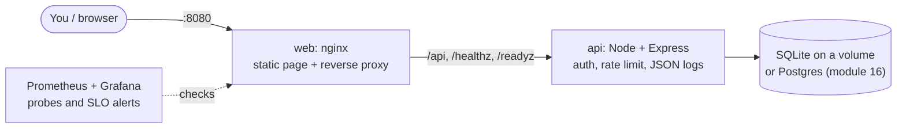
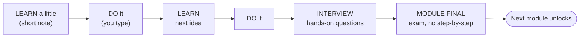

# DevOps and Cloud Lab


A personal, hands-on path from **zero to production-grade** DevOps and cloud skills. You ship, break, fix and operate one small but realistic application (a Node API with SQLite behind an nginx web page). Everything runs **locally and free** with Docker. Real-cloud steps are optional and clearly marked.

> Learn by doing: each module has a goal, exact commands, a **Check** that proves it worked, a **Break it** section, and industry notes. The findings and fixes in the READMEs came from actually running this lab (see [what was verified](#what-was-verified)).

## What you will operate


## Your journey

```mermaid
flowchart LR
  subgraph Beginner
    F[01 Foundations] --> C[02 Containers] --> M[03 Compose]
  end
  subgraph Intermediate
    CI[04 CI/CD] --> T[05 Terraform] --> K[06 Kubernetes]
  end
  subgraph Advanced
    G[07 GitOps] --> O[08 Observability] --> S[09 Security] --> R[10 SRE]
  end
  subgraph Expert
    X[11 Capstone]
  end
  subgraph Specialist["Specialist tracks"]
    N[12 Networking] --> AN[13 Ansible] --> H[14 Helm and RBAC] --> L[15 Logging and tracing] --> PG[16 Postgres] --> AW[17 Real cloud: AWS]
  end
  M --> CI
  K --> G
  R --> X
  X --> N
```


## Learning path

| Level | # | Module | You learn | Time |
|---|---|---|---|---|
| **Beginner** | [01](01-foundations/README.md) | Foundations | Linux, HTTP, Git, shell | 3h |
| | [02](02-containers/README.md) | Containers | secure images, nginx reverse proxy | 4h |
| | [03](03-compose/README.md) | Compose | multi-service stack, volumes, health, hardening | 3h |
| **Intermediate** | [04](04-ci-cd/README.md) | CI/CD | GitHub Actions, scanning, signed releases | 4h |
| | [05](05-terraform/README.md) | Infrastructure as Code | Terraform modules, tests, AWS APIs (free emulator) | 5h |
| | [06](06-kubernetes/README.md) | Kubernetes | probes, limits, HPA, StatefulSet, NetworkPolicy | 8h |
| **Advanced** | [07](07-gitops/README.md) | GitOps | Argo CD, drift, rollback by revert | 4h |
| | [08](08-observability/README.md) | Observability | Prometheus, Grafana, SLO burn-rate alerts | 4h |
| | [09](09-security/README.md) | DevSecOps | shift-left scanning, admission policy, supply chain | 4h |
| | [10](10-sre/README.md) | SRE | SLOs, runbooks, game days, postmortems | 4h |
| **Expert** | [11](11-capstone/README.md) | Capstone | DR drill, release end to end, DORA, readiness review | 10h+ |
| **Specialist** | [12](12-networking/README.md) | Networking | DNS, ports, TLS certificates, load balancing and failover | 2h |
| | [13](13-ansible/README.md) | Ansible | configuration management, idempotence, drift repair | 2h |
| | [14](14-helm/README.md) | Helm and RBAC | chart install/upgrade/rollback, least-privilege access | 2.5h |
| | [15](15-logging/README.md) | Logging and tracing | Loki + Alloy, LogQL, Jaeger traces | 2h |
| | [16](16-postgres/README.md) | Postgres | real database, scaling the API, pg_dump backup | 2h |
| | [17](17-aws/README.md) | Real cloud (AWS) | budget alarms, cloud security scanning, safe real-account apply | 2h |

Follow it in order; the lab moves on to the next lesson automatically. The core path is 01-11, the **specialist tracks** 12-17 go deeper. Do not skip **Break it**: operating skill comes from failures. Tick modules off as you finish them and keep notes on what broke.

## Start here: guided mode (easiest)
**Windows: just double-click `lab.cmd`.** It checks Docker and opens the lab in its own Git Bash window.

The lab teaches you **inside your terminal**. It explains each step, has you type the commands yourself, gives you hands-on tasks and **checks your work**.
```bash
export MSYS_NO_PATHCONV=1     # Windows Git Bash only, once per terminal
bash doctor.sh                # checks your machine (Docker, kubectl, memory)
bash lab.sh                   # menu: pick a lesson number
bash lab.sh 01                # or start module 01 directly (it continues by itself)
```
Every module follows the same path, and **the next module stays locked until you pass this one**:

- **LEARN**: a short teaching note (plain words, a few sentences). Read it, press Enter.
- **STEP** (do): the lab shows a command, **you type it** at the `▸` prompt. It runs it, shows the output, and tells you what to look for. A different command still runs (explore!) but only the right one completes the step. `?` = hint, `run` = let the lab type it for you, `skip`, `shortcuts`, `quit`.
- **YOUR TURN** (do): a hands-on task at a `lab ▸` prompt right in the lab (no second window): type commands, `edit FILE` opens nano, then `check`.
- **QUIZ**: a question in your own words, then the model answer.
- **INTERVIEW**: after the lessons the lab becomes an interviewer. It sets up a real situation (a broken site, a bad commit, a crash loop) and asks you to **show** the fix. No step-by-step help, hints only.
- **MODULE FINAL**: an exam of 3 hands-on challenges for the whole module. You get the objective, not the commands. Every item is checked against the real result, and all must pass to unlock the next module.

Menu symbols: `✔` module complete, `◐` lessons done but interview/final pending, `🔒` locked until the previous module is passed.
Failed an exam item? Retake only the exam with `bash lab.sh final 05` (change 05 to the module number).

Prefer to just watch? `LAB_MODE=watch bash lab.sh 01` runs the commands for you (press Enter at each step).

What it looks like in your terminal:
```text
 STEP 3/22  Build the API image
  Type this command (type it or copy it, then press Enter):
    ❯ docker build -f 02-containers/Dockerfile.api -t devlab-api:lab app/api
  ▸ docker build -f 02-containers/Dockerfile.api -t devlab-api:lab app/api
  │ ... Successfully built ...
   ✔ DONE
  ➜ Look for: The last lines say the image was built.

 YOUR TURN 9/22  Build an image from your own Dockerfile
  Type your commands right here. Type  check  when you are done.
  lab ▸ edit playground/Dockerfile.hello
  lab ▸ check
   ✔ PASS

  Overall  ████████░░░░░░░░░░░░░░░░  4/17 lessons   Rank: DevOps Engineer
```
You earn a rank as you go: Newcomer, Junior Operator, DevOps Engineer, Platform Engineer, Senior Engineer, SRE Legend.

Other commands: `bash lab.sh status` (your progress), `bash lab.sh final NN` (retake a module exam), `bash lab.sh next` (resume), `bash lab.sh down` (stop everything the labs started), `bash lab.sh reset`.
Your own files go in `playground/` (git-ignored). The written guides in each module folder have the same content plus background reading.

Requires Docker Desktop (give it 6GB+ RAM), `kubectl`, Git, Node 24+. Terraform, kind and helm are **optional**: wrapper scripts run them in Docker.

## Quick start without the guide (10 minutes)
```bash
C="docker compose -f 03-compose/docker-compose.yml --env-file .env"
$C up --build -d                         # builds both images and starts the site
curl localhost:8080/healthz              # {"ok":true}   (site: http://localhost:8080)
$C down                                  # stop (data volume is kept)
```

## Map
```
lab.sh  lessons/   guided runner and one lesson script per module (bash lab.sh 01 ...)
playground/        your own files from the hands-on tasks (git-ignored)
app/api/   sample API: Express, SQLite or Postgres, health + readiness, auth, rate limit, JSON logs, tests   (npm test)
app/web/   sample static site with a form that calls the API
01-foundations/ 02-containers/ 03-compose/ 04-ci-cd/ 05-terraform/ 06-kubernetes/
07-gitops/ 08-observability/ 09-security/ 10-sre/ 11-capstone/
12-networking/ 13-ansible/ 14-helm/ 15-logging/ 16-postgres/ 17-aws/      (specialist tracks)
doctor.sh  .env.example  RESOURCES.md
```
Change the app freely (add endpoints, break it, swap SQLite for Postgres): it exists to be operated.

## Rules of the lab
1. **Predict, then run.** Write what you expect before each command.
2. **Break something every module** and fix it from logs, not from the answer.
3. **Never reuse lab secrets** (`.env.example`, the dev overlay). They are public on purpose.
4. **Read every plan / diff** before applying.
5. Clean up: `docker compose ... down -v`, `bash 06-kubernetes/cluster.sh down`, `docker system prune`.

## Troubleshooting
| Symptom | Fix |
|---|---|
| `docker: failed to connect to the docker API` | start Docker Desktop, wait for "Engine running" |
| `required variable JWT_SECRET is missing` | `cp .env.example .env` (or run `doctor.sh`) |
| Port 8080/9090/3000/30080 in use | stop the other process or change the host port |
| `/data` permission errors | volume created by an older image: `docker compose ... down -v` |
| Git Bash mangles `/paths` in `docker run` | prefix with `MSYS_NO_PATHCONV=1` (scripts already do) |
| Containers crash after sleep / low RAM | raise Docker memory, `docker compose ... up -d` |

## What was verified
Run on Docker Desktop (Windows) while building this repo, **every lesson was executed end to end in an automatic mode that performs each hands-on task and checks the result** (the newer lessons also check the actual output, not just that a command exited cleanly):
- **Interviews and finals:** all 85 exam items (5 per module) were run the same way: the lab sets up the scenario (it breaks things on purpose), applies a reference solution, and the real check must pass.
- **01-03:** API tests, compose stack, nginx proxy, persistence, overrides, Git exercise.
- **04-05:** both workflows pass `actionlint`; Terraform fmt/validate/**2 tests**; real apply/drift-heal/destroy on LocalStack.
- **06-07:** Kustomize + schema validation; deployment to a **real k3s cluster** (self-healing with data kept, rolling restart, NetworkPolicy block, the SQLite scaling mistake).
- **08-11:** Prometheus probes and 7 alert rules, a real alert firing, five security scanners, a game day, and a **backup, destroy, restore** drill.
- **12 Networking:** DNS lookups, port clash, a self-signed TLS 1.3 server, a load balancer with failover.
- **13 Ansible:** two SSH-managed servers, idempotent playbook (`changed=0` on re-run), drift repaired on one server only.
- **14 Helm and RBAC:** chart lint, install, upgrade, rollback on the cluster; RBAC allow/deny checks.
- **15 Logging and tracing:** Loki + Alloy ingesting container logs, LogQL queries, a trace read back from Jaeger.
- **16 Postgres:** API switched to Postgres, scaled to 3 copies over one database, `pg_dump` restore.
- **17 AWS:** Terraform validate, Checkov (49 pass), and the risky-file fix exercise.

**Not run:** the GitHub Actions workflows on GitHub itself, the Argo CD and Kyverno installs, and anything that applies to a real AWS account (the lesson explains the checks and guardrails; those steps are optional).

See [RESOURCES.md](RESOURCES.md) for the research behind this curriculum and where to go next.
